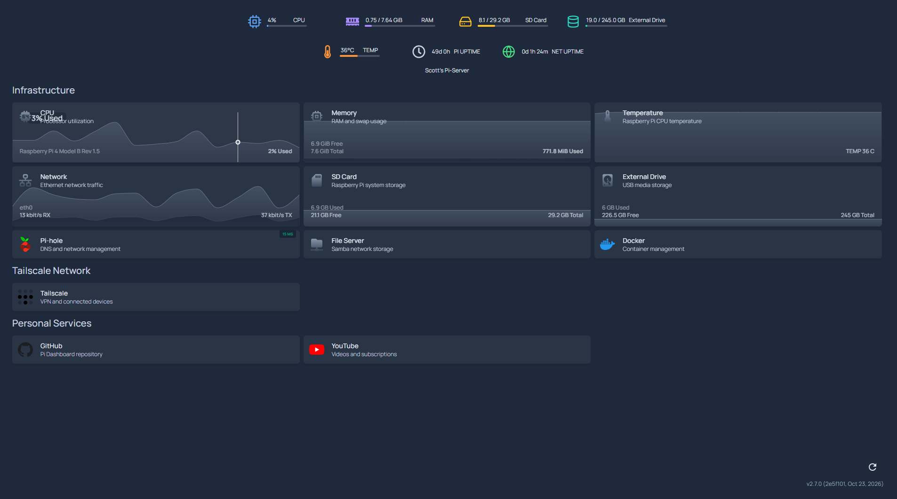

# Scott's Pi-Server Dashboard

A self-hosted monitoring dashboard for my Raspberry Pi, built using [Homepage](https://gethomepage.dev/), Docker Compose, Glances, Caddy, and Python.

The goal of this project is to create a centralized dashboard for monitoring my Raspberry Pi, tracking internet connectivity, and eventually managing visibility into other devices and services on my home network.

## Overview

The dashboard runs on a Raspberry Pi 4 (8 GB RAM) with Debian Linux and is accessible through a web browser on the local network.

It provides real-time system metrics, service monitoring, and a custom internet uptime tracker.

## Dashboard Preview


*Development snapshot - November 2nd, 2026*

### Features

- **CPU monitoring:** Live CPU utilization.
- **Memory monitoring:** Used and total system RAM, retrieved from the Glances API.
- **Storage monitoring:** Used and total storage for the Pi's SD card and external drive.
- **Temperature monitoring:** Raspberry Pi CPU temperature.
- **System uptime:** Time elapsed since the Raspberry Pi last booted.
- **Internet uptime:** Tracks continuous internet connectivity independently of system uptime.
- **Responsive design:** Custom layouts for desktop, tablet, and mobile.
- **Custom styling:** Colour-coded resource icons, progress bars, and a centered resource dashboard.
- **Service dashboard:** Homepage service cards for quick access to configured services.

## Technology Stack

| Technology | Purpose |
|---|---|
| Raspberry Pi 4 | Host hardware |
| Debian Linux | Host operating system |
| Docker Compose | Container orchestration |
| Homepage | Dashboard interface |
| Glances | System monitoring and metrics API |
| Caddy | Reverse proxy for Homepage and monitoring APIs |
| Python 3 | Internet connectivity monitoring and status API |
| systemd | Starts and supervises the internet monitor |
| GitHub | Version control and project documentation |

## Architecture

The project consists of four Docker services and one host-level systemd service.

```text
                     Local Network
                           |
                           v
                   Raspberry Pi :3000
                           |
                           v
                    Caddy Reverse Proxy
                           |
          +----------------+----------------+
          |                |                |
          v                v                v
       Homepage       Glances API      Internet Status API
       Dashboard      (port 61208)       (port 8080)
          |                                  |
          |                                  v
          |                         internet-status.json
          |                                  ^
          |                                  |
          |                         Python Internet Monitor
          |                                  |
          |                                  v
          |                          Connectivity Check
          |                          Every 30 Seconds
          |
          v
     Browser Widgets
```

Caddy routes requests to the appropriate service:

| Endpoint | Destination |
|---|---|
| `/` | Homepage |
| `/glances-memory` | Glances memory API |
| `/internet-status` | Python internet status API |

Only port `3000` is published by the Docker Compose configuration.

## Project Structure

```text
pi-dashboard/
├── compose.yaml
├── .gitignore
├── config/
│   ├── custom.css
│   ├── custom.js
│   ├── widgets.yaml
│   └── ...
├── monitor/
│   ├── internet_monitor.py
│   ├── status_api.py
│   └── systemd/
│       └── pi-internet-monitor.service
└── proxy/
    └── Caddyfile
```

### Configuration Files

**`compose.yaml`**

Defines the Docker services, internal networking, bind mounts, and exposed dashboard port.

**`config/widgets.yaml`**

Configures Homepage's Glances integration and the system resources displayed in the dashboard header.

**`config/custom.css`**

Implements the custom 4+3 desktop resource layout, colour-coded metrics, responsive breakpoints, and widget spacing.

**`config/custom.js`**

Adds custom storage calculations, RAM used/total formatting, an internet uptime widget, and automatic restoration of custom formatting when Homepage redraws its interface.

**`monitor/internet_monitor.py`**

Runs on the host operating system and periodically checks internet connectivity.

**`monitor/status_api.py`**

Runs in a Docker container and provides the latest internet connectivity status as JSON.

**`proxy/Caddyfile`**

Routes browser requests to Homepage and the internal monitoring APIs.

## Internet Uptime Monitoring

Internet uptime is tracked separately from Raspberry Pi uptime.

The monitoring script requests:

`https://www.google.com/generate_204`

Every 30 seconds, it checks whether the endpoint responds with HTTP status `204`.

### Outage Detection

To avoid treating isolated network failures as full outages, the monitor requires three consecutive failed checks before marking the internet offline.

With a 30-second check interval, this generally means an outage is detected after approximately 60–95 seconds, depending on when failures occur and request timeouts.

When connectivity returns, the monitor records a new `online_since` timestamp.

### Persistence

The monitor writes its current status to:

`/var/lib/pi-dashboard/internet-status.json`

Updates use a temporary file followed by an atomic replacement, reducing the chance of the API reading a partially written status file.

The monitor also records the Linux boot ID to prevent uptime from incorrectly carrying over between Raspberry Pi reboots.

### Dashboard Updates

The browser retrieves internet status every 30 seconds and updates the displayed uptime every second.

The widget displays:

- Green icon: internet connection online.
- Red icon: internet connection offline.
- Unknown status: monitoring information is unavailable or stale.

The displayed uptime represents continuous connectivity since the most recent detected outage or monitor reset, rather than a historical availability percentage.

## Installation

These instructions assume a Debian-based Raspberry Pi with Docker and the Docker Compose plugin installed.

### 1. Clone the repository

```bash
git clone https://github.com/dscottsalmon/pi-dashboard.git
cd pi-dashboard
```

### 2. Review local configuration

Before starting the dashboard, review:

- `compose.yaml` for bind mounts, hostnames, and storage paths.
- `config/widgets.yaml` for Glances configuration.
- `config/custom.js` for the configured SD card and external drive capacities.
- `monitor/systemd/pi-internet-monitor.service` for the correct username and installation directory.

The current configuration was developed for a specific Raspberry Pi installation and is not fully portable without adjusting these settings.

### 3. Start the Docker services

```bash
sudo docker compose up -d
```

Check their status:

```bash
sudo docker compose ps
```

### 4. Install the internet monitoring service

Copy the included systemd unit:

```bash
sudo cp monitor/systemd/pi-internet-monitor.service \
  /etc/systemd/system/
```

Ensure the `User`, `Group`, `WorkingDirectory`, and `ExecStart` values match your installation.

Then enable the service:

```bash
sudo systemctl daemon-reload
sudo systemctl enable --now pi-internet-monitor.service
```

Check its status:

```bash
sudo systemctl status pi-internet-monitor.service
```

### 5. Open the dashboard

Navigate to:

`http://<raspberry-pi-hostname>:3000`

The hostname or IP address must also be permitted by the `HOMEPAGE_ALLOWED_HOSTS` setting in `compose.yaml`.

## Maintenance

### View Docker service status

```bash
sudo docker compose ps
```

### View container logs

```bash
sudo docker compose logs --tail=100
```

### View internet monitor logs

```bash
sudo journalctl -u pi-internet-monitor.service -f
```

### Restart the dashboard

```bash
sudo docker compose restart
```

### Validate the configuration

```bash
sudo docker compose config --quiet
```

### Update Docker images

```bash
sudo docker compose pull
sudo docker compose up -d
```

Review release notes and configuration compatibility before updating, especially because the Compose file currently uses moving image tags.

## Security Considerations

- The dashboard is intended for access over a trusted local network or a private VPN.
- No router port forwarding is required.
- Homepage and the monitoring APIs are exposed through Caddy on port `3000`.
- The internet status API has no authentication and should not be exposed publicly.
- Glances is accessed through Docker's internal network.
- The Glances container does not require a Docker socket mount.
- Credentials, environment files, local backups, and generated Python files are excluded from Git using `.gitignore`.

## Roadmap

- [x] Deploy Homepage using Docker Compose.
- [x] Integrate Glances system monitoring.
- [x] Customize CPU, RAM, storage, and temperature metrics.
- [x] Implement independent internet uptime monitoring.
- [x] Add Caddy reverse proxy.
- [x] Create responsive desktop and mobile layouts.
- [x] Add colour-coded icons and progress bars.
- [ ] Add Tailscale device-status monitoring.
- [ ] Expand service health monitoring.
- [ ] Add historical network availability statistics.
- [ ] Improve portability and installation automation.

## Project Status

**Active development.**

This is a personal homelab project used to experiment with Linux administration, Docker, networking, system monitoring, Python, and frontend customization.
